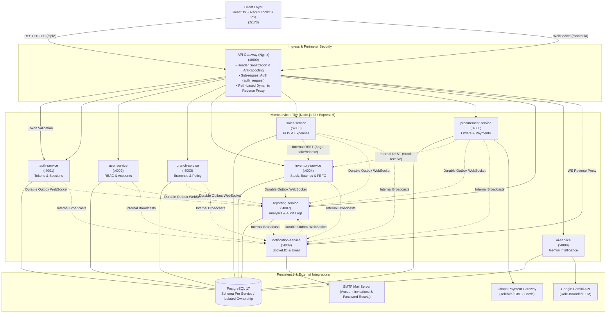
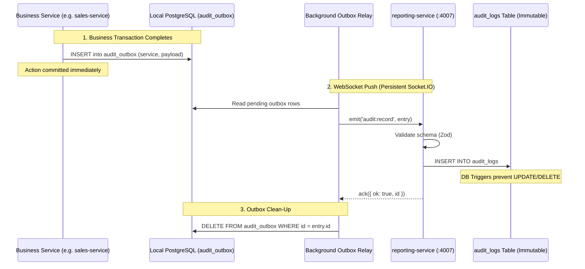
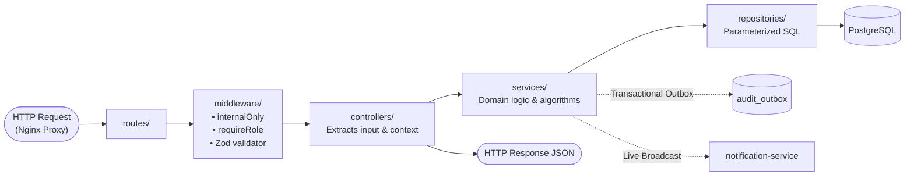

# Multi-Branch Supermarket Inventory Management System

A production-ready enterprise inventory, point-of-sale, procurement, and multi-branch management platform built with a **Microservices Architecture** on the backend and a modern **Layered Code Organization** across both client and server codebases.

The platform provides end-to-end multi-branch retail operations: batch-level stock tracking, **FEFO (First Expired, First Out)** automated stock exhaustion, multi-step procurement with **Chapa** payment gateway integration, tamper-proof immutable audit logging enforced at the database engine level, real-time reactive UI updates via **Socket.IO**, and role-governed AI decision support powered by **Google Gemini**.

---

## Table of Contents

- [1. System Architecture: Microservices Architecture](#1-system-architecture-microservices-architecture)
  - [1.1 Architectural Overview](#11-architectural-overview)
  - [1.2 Microservice Decomposition Matrix](#12-microservice-decomposition-matrix)
  - [1.3 Inter-Service Communication & Coordination Patterns](#13-inter-service-communication--coordination-patterns)
  - [1.4 Ingress & API Gateway Security Model](#14-ingress--api-gateway-security-model)
  - [1.5 Transactional Outbox & Event Streaming](#15-transactional-outbox--event-streaming)
- [2. Code Organization: Layered Architecture](#2-code-organization-layered-architecture)
  - [2.1 Backend Layered Architecture (All Services)](#21-backend-layered-architecture-all-services)
  - [2.2 Backend Request Processing Lifecycle](#22-backend-request-processing-lifecycle)
  - [2.3 Frontend Layered Architecture (React Client)](#23-frontend-layered-architecture-react-client)
- [3. Users & Role-Based Access Control (RBAC)](#3-users--role-based-access-control-rbac)
- [4. Functional Requirements](#4-functional-requirements)
  - [4.1 Identity, Authentication & Session Security](#41-identity-authentication--session-security)
  - [4.2 User Management & Account Provisioning](#42-user-management--account-provisioning)
  - [4.3 Multi-Branch Administration & Operational Policy](#43-multi-branch-administration--operational-policy)
  - [4.4 Category & Product Catalog Management](#44-category--product-catalog-management)
  - [4.5 Procurement & Payment Processing](#45-procurement--payment-processing)
  - [4.6 Inventory Management & Batch Tracking (FEFO)](#46-inventory-management--batch-tracking-fefo)
  - [4.7 Point of Sale (POS) & Expense Tracking](#47-point-of-sale-pos--expense-tracking)
  - [4.8 Analytics, Reporting & Immutable Audit Trail](#48-analytics-reporting--immutable-audit-trail)
  - [4.9 AI-Powered Role Assistance & Recommendations](#49-ai-powered-role-assistance--recommendations)
  - [4.10 Real-Time Event Dispatch & Notifications](#410-real-time-event-dispatch--notifications)
- [5. Non-Functional Requirements](#5-non-functional-requirements)
  - [5.1 Security & Protection](#51-security--protection)
  - [5.2 Data Integrity & Concurrency Control](#52-data-integrity--concurrency-control)
  - [5.3 Reliability, Fault Isolation & Resilience](#53-reliability-fault-isolation--resilience)
  - [5.4 Performance & Scalability](#54-performance--scalability)
  - [5.5 Maintainability & Extensibility](#55-maintainability--extensibility)
  - [5.6 Usability & Accessibility](#56-usability--accessibility)
  - [5.7 Auditability & Compliance](#57-auditability--compliance)
  - [5.8 Timezone & Regional Standardization](#58-timezone--regional-standardization)
- [6. Technology Stack](#6-technology-stack)
- [7. Directory Structure](#7-directory-structure)
- [8. Getting Started & Deployment](#8-getting-started--deployment)
  - [8.1 Prerequisites](#81-prerequisites)
  - [8.2 Environment Configuration](#82-environment-configuration)
  - [8.3 Running with Docker Compose](#83-running-with-docker-compose)
  - [8.4 Initializing the System & Seeding Owner Account](#84-initializing-the-system--seeding-owner-account)
  - [8.5 Running the Frontend Client](#85-running-the-frontend-client)
- [9. Configuration Environment Variables](#9-configuration-environment-variables)

---

## 1. System Architecture: Microservices Architecture

The system is strictly architected as a **Microservices Architecture**. Rather than a monolithic backend, business domains are isolated into nine specialized, autonomous Node.js/Express microservices fronted by a reverse-proxy **API Gateway** powered by Nginx.

Each microservice encapsulates its own domain business logic, data models, validation rules, migrations, and database tables.

### 1.1 Architectural Overview



### 1.2 Microservice Decomposition Matrix

Each microservice encapsulates a cohesive bounded context:

| Microservice | Internal Port | Primary Responsibility | Dedicated Database Tables | Inbound Route Patterns |
|---|---|---|---|---|
| **api-gateway** | `8000` | Single entry point, SSL termination, route dispatching, token verification (`auth_request`), header sanitization | *None (stateless)* | `/api/*`, `/socket.io/*`, `/health` |
| **auth-service** | `4001` | Sign-in, sign-out, JWT issuance, session activity tracking, password reset, login rate-limiting | `personal_access_tokens`, `account_sign_ins`, `password_reset_tokens` | `/auth/*`, `/sessions/*`, `/internal/auth/*` |
| **user-service** | `4002` | Staff accounts, email invitation lifecycle, account status, dormant account reviews, role management | `users`, `account_invitations`, `account_role_changes`, `account_changes`, `access_reviews` | `/accounts/*`, `/invitations/*`, `/access-reviews/*`, `/internal/accounts/*` |
| **branch-service** | `4003` | Store branch CRUD, operating status, store-wide thresholds (low stock, expiry notice days) | `branches`, `policy_settings` | `/branches/*`, `/policy/*`, `/internal/branches/*` |
| **inventory-service** | `4004` | Catalog products, auto-generated Batch IDs, batch-level stock quantities, branch transfers, damaged items | `products`, `stock_batches`, `stock_movements`, `stock_transfers`, `stock_adjustments`, `damaged_items`, `audit_outbox` | `/products/*`, `/stock/*`, `/transfers/*`, `/damaged-items/*`, `/internal/stock/*` |
| **sales-service** | `4005` | FEFO POS sales processing, idempotency management, branch daily operational expenses | `sales`, `expenses`, `audit_outbox` | `/sales/*`, `/expenses/*` |
| **procurement-service** | `4006` | Purchase categories, supplier purchase orders, Chapa payment processing, goods receiving workflow | `procurement_categories`, `procurements`, `audit_outbox` | `/procurements/*`, `/internal/procurements/*` |
| **reporting-service** | `4007` | Aggregate reporting (Sales, Inventory, Financial, Procurement, User), Owner Dashboard, centralized immutable audit log receiver | `audit_logs` | `/reports/*`, `/dashboard/*`, `/audit-logs/*`, `/internal/audit-socket` |
| **ai-service** | `4008` | Role-bounded operational recommendations, sales & demand forecasting, conversational LLM assistance via Google Gemini | `audit_outbox` *(reads shared read-only tables via scoped models)* | `/ai/*` |
| **notification-service** | `4009` | Real-time WebSocket event broadcasting (Socket.IO rooms) and transactional outbound emails (SMTP) | `audit_outbox` | `/socket.io/*`, `/internal/broadcast`, `/internal/mail` |

### 1.3 Inter-Service Communication & Coordination Patterns

The system avoids fragile, tightly-coupled synchronous cascades by adopting established enterprise integration patterns:

1. **Synchronous Inter-Service REST (Orchestration & Sagas):**
   - Services communicate over private container network addresses using internal endpoints under `/internal/*`.
   - Every request is guarded by constant-time verification of `x-internal-secret`.
   - **Distributed Two-Phase Stock Reservation (Saga Pattern):** When `sales-service` records a sale, it executes a two-phase coordinated reservation:
     - Phase 1: Calls `inventory-service` at `POST /internal/stock/take` with a unique deterministic idempotency reference (`sale:{seller_id}:{idempotency_key}`).
     - Phase 2: Commits the local sale record. If the database commit fails, the catch block issues a compensating transaction to `inventory-service` at `POST /internal/stock/release` to restore the reserved units automatically.
2. **Asynchronous Real-Time Event Broadcasting:**
   - When entities mutate (e.g., stock changes, sales recorded, invitations accepted), the originating service fires a background HTTP request to `notification-service` (`POST /internal/broadcast`).
   - `notification-service` pushes targeted updates to scoped Socket.IO client channels (e.g., `branch.{branchId}.stock`).

### 1.4 Ingress & API Gateway Security Model

The API Gateway (Nginx) enforces perimeter zero-trust security:

```
[Browser Request: Authorization: Bearer <token>]
                         │
                         ▼
             [Nginx API Gateway :8000]
     ┌───────────────────┴───────────────────┐
     │ 1. Strip incoming spoofed headers:    │
     │    x-internal-secret, x-auth-context  │
     │ 2. Reject public access to /internal  │
     └───────────────────┬───────────────────┘
                         │
                         ▼
        [auth_request to auth-service:4001]
          GET /internal/auth/gateway-check
     ┌───────────────────┴───────────────────┐
     │ 3. Validate JWT & Session Record:     │
     │    • Check expiration & inactivity    │
     │    • Update last activity timestamp   │
     │    • Return 204 with X-Auth-Context   │
     └───────────────────┬───────────────────┘
                         │
                         ▼
      [Forward to Target Microservice :400x]
     ┌───────────────────┴───────────────────┐
     │ 4. Rewrite URL: /api/sales -> /sales  │
     │ 5. Inject trusted x-internal-secret   │
     │ 6. Inject base64url x-auth-context    │
     └───────────────────────────────────────┘
```

1. **Header Stripping:** Any inbound browser headers matching `x-internal-secret` or `x-auth-context` are dropped immediately at the edge.
2. **Token Introspection (`auth_request`):** Nginx intercepts every `/api/*` call and executes an internal sub-request to `auth-service` (`GET /internal/auth/gateway-check`).
3. **Identity Context Propagation:** `auth-service` unpacks the bearer token, verifies session activity and database status, and returns `x-auth-context` containing user identity (`id`, `role`, `branchId`, `status`). Nginx forwards this signed payload to downstream services.
4. **Internal Route Concealment:** Requests attempting to target `/internal` or `/api/internal` directly from outside are rejected with `404 Not Found`.

### 1.5 Transactional Outbox & Event Streaming

Audit logs require zero loss even if `reporting-service` experiences temporary network interruptions or restarts. The system utilizes the **Transactional Outbox Pattern**:



- Each microservice writes audit events into its local `audit_outbox` table.
- A persistent background WebSocket relay connects to `reporting-service` at `/internal/audit-socket` authenticating with `INTERNAL_SERVICE_SECRET`.
- Entries are streamed in real time. `reporting-service` validates payload schemas using Zod, records them into `audit_logs`, and responds with an acknowledgment. Only upon acknowledgment does the originating service delete the outbox record.

---

## 2. Code Organization: Layered Architecture

Both the backend microservices and the React frontend are designed around a strict, predictable **Layered Code Organization**. Each layer possesses distinct responsibilities and enforces unidirectional dependencies.

### 2.1 Backend Layered Architecture (All Services)

Every microservice under `server/` implements an identical structural pattern:

```
server/<service-name>/
├── index.js                  # Service bootstrapping, route binding, port listen
├── migrate.js                # Migration runner executing migrations/*.sql
├── migrations/               # Sequential, idempotent SQL DDL/DML migrations
├── routes/                   # HTTP Route definitions & middleware wiring
│   ├── index.js
│   ├── *.routes.js
│   └── internal.routes.js    # Protected service-to-service endpoints
├── middleware/               # Gatekeeping, authentication & validation
│   ├── auth.js               # RBAC & account status verification
│   ├── internalOnly.js       # Shared secret & context decoding
│   ├── rateLimit.js          # IP & user-level rate limiting
│   └── validators/           # Zod declarative schema validation rules
├── controllers/              # HTTP transport handlers (request/response shaping)
├── services/                 # Pure domain logic, orchestration, algorithms (FEFO, sagas)
├── repositories/             # Direct PostgreSQL data access layer (parameterized SQL)
├── models/                   # Domain entities, constants, DTO transformers
└── utils/                    # Shared runtime helpers (DB pool, logger, events, errors)
```

#### Detailed Layer Responsibilities:

| Layer | Directory | Permitted Dependencies | Forbidden Actions | Primary Responsibilities |
|---|---|---|---|---|
| **Routes** | `routes/` | Middleware, Controllers | Business logic, direct DB queries | Maps HTTP verbs and URI paths to controller methods; chains authentication and validation middleware. |
| **Middleware** | `middleware/` | Models, Validators, Utils | Business logic orchestration | Checks RBAC permissions, decodes `x-auth-context`, enforces rate limits, validates incoming request bodies via Zod. |
| **Controllers** | `controllers/` | Services, Models, Utils | SQL queries, raw domain math | Unpacks request params/body/query; delegates work to domain services; formats HTTP status codes and JSON responses. |
| **Services** | `services/` | Repositories, Models, Utils, Service Clients | Direct HTTP `req`/`res` manipulation | Encapsulates all business logic: FEFO sorting, multi-batch deductions, distributed sagas, audit event publishing, financial calculations. |
| **Repositories** | `repositories/` | Database Pool (`db.js`), Models | HTTP concepts, inter-service calls | The **only** layer permitted to execute SQL. Executes parameterized queries, transactions, row locking (`FOR UPDATE`), and keyset pagination. |
| **Models** | `models/` | None (pure domain definitions) | Database I/O, network calls | Declares table names, column constraints, entity states, enum types, and transforms raw database tuples into API resource DTOs. |
| **Migrations** | `migrations/` | PostgreSQL DDL | Application code | Idempotent SQL scripts managing schema evolution, indexes, constraints, and database triggers. |

### 2.2 Backend Request Processing Lifecycle



### 2.3 Frontend Layered Architecture (React Client)

The client application (`client/`) mirrors the separation of concerns through an enterprise layered design:

```
client/
├── api/                      # Backend API clients (Axios/fetch wrappers per domain)
├── components/               # Pure, reusable UI primitives (Table, Modal, Tag, Notice)
├── features/                 # Domain feature modules (encapsulated components & slices)
│   ├── accounts/             # Staff provisioning, session monitoring, dormant review
│   ├── aiAssistance/         # AI assistant drawer, role prompt chat, recommendation cards
│   ├── auditLogs/            # Keyset-paginated audit trail viewer with diff snapshots
│   ├── auth/                 # Sign-in forms, password reset, token lifecycle
│   ├── branches/             # Branch listing, creation, and editing modals
│   ├── damaged/              # Damaged stock logging and loss valuation
│   ├── dashboard/            # Multi-branch metrics, KPI summary cards, bar & donut charts
│   ├── expenses/             # Branch expense recording and categorization
│   ├── inventory/            # Stock list, batch correction, inventory alerts
│   ├── notifications/        # Live notification center & subscription listener
│   ├── policy/               # Store policy settings (low-stock & expiry thresholds)
│   ├── purchases/            # Purchase orders, Batch ID assignment, Chapa checkout modal
│   ├── reports/              # Tabular report generators & jsPDF report exporters
│   ├── sales/                # Point of sale interface, FEFO auto-selection modal
│   └── transfers/            # Multi-branch stock transfer & receiving workflow
├── layouts/                  # App shell containers (DashboardLayout, AuthLayout)
├── pages/                    # High-level route screen views
├── redux/                    # Central Redux Toolkit store, state persistence, middleware
├── routes/                   # React Router 7 setup, RoleRoute guards, navigation matrix
└── utils/                    # Formatting (currency, dates), FEFO sorting helpers, HTTP client
```

#### Client Layered Interaction:
- **`pages/`**: Thin composition containers mapping route URLs to layout shells and feature modules.
- **`features/<area>/`**: Self-contained domain modules containing feature-specific components, custom hooks, business rules, and Redux slices.
- **`api/`**: Explicit HTTP client modules isolating network serialization, headers, and endpoints from the UI.
- **`redux/`**: Centralized reactive state store managing asynchronous thunks, cross-cutting auth tokens, and session persistence.
- **`routes/RoleRoute.jsx`**: Client-side RBAC guard checking authorized section keys against `user.sections` before rendering.

---

## 3. Users & Role-Based Access Control (RBAC)

The system implements strict Role-Based Access Control across four distinct enterprise operational roles:

| Role | Branch Operational Scope | Permitted System Capabilities | Primary UI Sections |
|---|---|---|---|
| **Owner** | **Global (All Branches)** | Full supervisory privileges: staff provisioning, branch administration, enterprise dashboard, all analytical reports, immutable audit trail inspection, AI decision support. | Dashboard, Account Provision, Branches, Reports (Sales, Inventory, Financial, Procurement, User), Audit Logs, AI Assistance |
| **Inventory Officer** | **Local (Assigned Branch)** | Day-to-day stock reception, batch expiry & quantity adjustments, initiating/receiving branch transfers, writing off damaged goods, recording branch expenses, setting store threshold policies. | Dashboard, Inventory, Stock Transfers, Damaged, Expenses, Settings (Policy), Inventory Report, Notifications |
| **Cashier** | **Local (Assigned Branch)** | Front-counter Point of Sale transactions, automated FEFO batch exhaustion, daily sales report inspection. | Dashboard, Sales, Sales Report |
| **Purchase Officer** | **Global (All Branches)** | Vendor procurement lifecycle, product & category catalog maintenance, automatic Batch ID assignment, initiating Chapa payment transactions, procurement reporting. | Dashboard, Purchase, Category & Product, Procurement Report |

---

## 4. Functional Requirements

### 4.1 Identity, Authentication & Session Security
- **FR-1 [Email Invitations]:** The Owner shall invite new personnel via email. The system generates a cryptographic invitation token allowing the recipient to securely set their password.
- **FR-2 [Authentication Lifecycle]:** Users shall authenticate using email and password. Upon successful login, the system issues a secure JWT token linked to an active database session record.
- **FR-3 [Inactivity Timeout]:** The system shall track user activity timestamps and automatically invalidate sessions after a configurable inactivity threshold (`SESSION_TIMEOUT_MINUTES`).
- **FR-4 [Session Monitoring & Termination]:** The Owner shall view all active user sessions displaying device user-agent, IP address, login time, and last activity time, with the ability to revoke any session remotely.
- **FR-5 [Password Recovery]:** The system shall provide a self-service password reset flow utilizing time-limited, single-use email tokens.

### 4.2 User Management & Account Provisioning
- **FR-6 [Staff Account Administration]:** The Owner shall modify staff details, update roles, reassign operational branches, and activate or deactivate accounts.
- **FR-7 [Dormant Account Detection]:** The system shall automatically identify dormant accounts—active users who have not authenticated within a configurable duration (`ACCESS_REVIEW_DORMANT_DAYS`)—and allow immediate one-click deactivation.
- **FR-8 [Instant Revocation]:** Deactivating a user account shall instantly revoke all associated active access tokens and disconnect live WebSocket subscriptions.

### 4.3 Multi-Branch Administration & Operational Policy
- **FR-9 [Branch Lifecycle]:** The Owner shall create, edit, activate, and deactivate supermarket branch locations. Branches containing active staff, sales history, or stock balances cannot be hard-deleted.
- **FR-10 [Branch Operational Policy]:** Inventory Officers shall configure branch-specific inventory thresholds, including low-stock warning limits and near-expiry warning windows (in days).

### 4.4 Category & Product Catalog Management
- **FR-11 [Catalog Taxonomy]:** Purchase Officers shall define product categories and products.
- **FR-12 [System Batch ID Generation]:** Every registered product shall automatically receive a unique sequential system Batch ID (`BT-00001`, `BT-00002`, etc.). Products may be re-entered under new distinct Batch IDs for subsequent shipments.

### 4.5 Procurement & Payment Processing
- **FR-13 [Purchase Order Generation]:** Purchase Officers shall create purchase orders specifying category, product, target Batch ID, supplier details, ordered quantity, and total purchase cost.
- **FR-14 [Single-Purchase Batch Enforcement]:** A given Batch ID can be procured **exactly once**. Any attempt to create a second procurement referencing an existing Batch ID shall be rejected by the database.
- **FR-15 [Payment Gateway Integration]:** Procurements shall be processed via the Chapa payment gateway (supporting local cards, Telebirr, and CBE Birr). A simulated test mode (`CHAPA_MODE=fake`) shall be provided for development environments.
- **FR-16 [Stock Receiving Workflow]:** Upon successful payment confirmation, the destination branch's Inventory Officer shall receive the delivery by providing selling price and verified expiration dates, transitioning the batch into active branch inventory.

### 4.6 Inventory Management & Batch Tracking (FEFO)
- **FR-17 [Batch-Level Inventory]:** Inventory shall be tracked granularly per branch, product, and specific Batch ID, maintaining distinct purchase prices, selling prices, and expiration dates.
- **FR-18 [Stock Adjustments]:** Inventory Officers shall execute authorized quantity corrections and expiry adjustments, recording clear operational rationales.
- **FR-19 [Inter-Branch Stock Transfers]:** Inventory Officers shall initiate stock transfers between branches. The source branch stock is decremented immediately upon dispatch, and the destination branch increments stock upon verified receipt.
- **FR-20 [Damaged & Expired Write-Offs]:** Damaged or expired goods shall be written off with documented reasons and financial loss values, immediately removing the units from sellable inventory.
- **FR-21 [Proactive Inventory Alerts]:** The system shall alert staff to low-stock quantities and near-expiry batches based on configured branch policy thresholds.

### 4.7 Point of Sale (POS) & Expense Tracking
- **FR-22 [Automated FEFO Deduction]:** When a Cashier records a sale, the system shall automatically allocate stock from the batch expiring soonest (**First Expired, First Out**). Cashiers are prevented from manually bypassing expiration priority.
- **FR-23 [Idempotent Sales Submission]:** Every sale request shall include a client-generated UUID `Idempotency-Key`. Duplicate submissions (e.g., double clicks or network retries) shall return the existing sale without re-deducting stock.
- **FR-24 [Branch Expense Logging]:** Inventory Officers shall record operational branch expenses (utilities, transport, maintenance) to ensure accurate net profit calculations.

### 4.8 Analytics, Reporting & Immutable Audit Trail
- **FR-25 [Analytical Reports]:** The system shall generate tabular and graphical reports for custom date ranges and branch filters, with one-click export to PDF:
  - *Sales Report:* Volume, revenue, top-selling items, cashier breakdown.
  - *Inventory Report:* Stock valuation, near-expiry warnings, low-stock warnings, turnover rate.
  - *Financial Report:* Net revenue, Cost of Goods Sold (COGS), operational expenses, net profit/loss.
  - *Procurement Report:* Supplier spend, pending vs. received orders, unit cost trends.
  - *User Report:* Staff access logs, role change histories, dormant account audit.
- **FR-26 [Executive Owner Dashboard]:** The Owner dashboard shall provide aggregated multi-branch KPI metrics, comparative revenue charts, top-performing products, and cross-branch performance summaries.
- **FR-27 [Tamper-Proof Immutable Audit Trail]:** Every critical system action (create, update, delete, approve, reject, login, logout, and page view) shall be permanently recorded with the acting user, timestamp, IP address, module, record ID, and complete **before/after JSON snapshot diffs**. Database triggers shall forbid modifications or deletions.

### 4.9 AI-Powered Role Assistance & Recommendations
- **FR-28 [Role-Bounded Operational Recommendations]:** Google Gemini shall analyze daily transactional data to generate prioritized operational recommendations tailored strictly to the requesting user's role scope.
- **FR-29 [Conversational Analytics Chat]:** An integrated conversational AI assistant shall answer operational queries using real-time figures extracted from the user's permissible data boundary.

### 4.10 Real-Time Event Dispatch & Notifications
- **FR-30 [Reactive UI Updates]:** User interfaces shall update dynamically without manual browser refreshing via Socket.IO events (e.g., live stock changes, newly recorded sales, session revocations, and system alerts).

---

## 5. Non-Functional Requirements

### 5.1 Security & Protection
- **NFR-1 [Perimeter Defense & Header Sanitization]:** The API Gateway shall strip all incoming client headers matching internal security headers (`x-internal-secret`, `x-auth-context`) to prevent identity spoofing.
- **NFR-2 [Zero Direct Service Exposure]:** Downstream microservices shall operate strictly within an internal isolated Docker network; public traffic is accepted exclusively through the Nginx gateway on port 8000.
- **NFR-3 [Service-to-Service Authentication]:** All internal REST endpoints (`/internal/*`) and internal WebSockets shall validate a high-entropy shared secret (`INTERNAL_SERVICE_SECRET`) using timing-safe comparisons (`crypto.timingSafeEqual`).
- **NFR-4 [Credential Protection]:** Passwords shall be salted and hashed using `bcrypt` (10 rounds). Tokens and passwords shall be stripped from audit snapshots before database insertion.
- **NFR-5 [Rate Limiting]:** Public authentication routes (login, password reset, invitation acceptance) and AI query endpoints shall enforce IP and user-based rate limit windows to mitigate brute-force and DDoS attacks.

### 5.2 Data Integrity & Concurrency Control
- **NFR-6 [Negative Stock Prohibition]:** Database-level check constraints (`stock_batches_units_not_negative`) shall guarantee that inventory quantities can never drop below zero under any concurrency condition.
- **NFR-7 [Pessimistic Row-Level Locking]:** Concurrent stock modifications shall utilize row locks (`SELECT ... FOR UPDATE` with deterministic batch ID ordering) to prevent race conditions and deadlocks during simultaneous multi-item checkouts.
- **NFR-8 [Idempotency Safeguards]:** Point-of-sale transactions and procurement receipts shall enforce unique database constraints on idempotency keys to prevent duplicate billing or duplicate inventory addition.

### 5.3 Reliability, Fault Isolation & Resilience
- **NFR-9 [Process Isolation]:** Every microservice shall run in an independent container with its own restart policy (`restart: unless-stopped`). A crash in one service (e.g., AI assistance) shall not affect sales, authentication, or inventory operations.
- **NFR-10 [Guaranteed Audit Delivery]:** The Transactional Outbox pattern shall ensure that audit events survive downstream network failures, persisting locally until confirmed by `reporting-service`.
- **NFR-11 [Graceful Degradation]:** If an external integration (Google Gemini or Chapa) experiences downtime, affected modules shall respond with informative, standardized JSON error messages without crashing host services.

### 5.4 Performance & Scalability
- **NFR-12 [Stateless Microservice Scaling]:** All backend services shall remain strictly stateless, allowing horizontal scaling behind load-balanced gateway proxies.
- **NFR-13 [Keyset Cursor Pagination]:** The audit log and large reporting datasets shall implement keyset (cursor) pagination using indexed composite keys (`(occurred_at, id)`), ensuring constant-time ($O(1)$) pagination performance regardless of dataset depth.
- **NFR-14 [Optimized AI Caching]:** LLM operational recommendations shall be cached in-memory with a 30-minute sliding window per user role to minimize latency and API consumption.

### 5.5 Maintainability & Extensibility
- **NFR-15 [Uniform Layering Convention]:** Every microservice shall adhere to the identical layered pattern (`routes` → `middleware` → `controllers` → `services` → `repositories` → `models`), simplifying code navigation and onboarding.
- **NFR-16 [Automated Database Evolution]:** Each microservice shall automatically discover and execute its own versioned SQL migrations upon container startup.

### 5.6 Usability & Accessibility
- **NFR-17 [Responsive Design]:** The web interface shall deliver a responsive, accessible layout functional across desktop monitors, tablets, and mobile devices.
- **NFR-18 [Granular Form Validation]:** Client-side and server-side validation errors shall map directly to individual form fields with descriptive inline feedback.

### 5.7 Auditability & Compliance
- **NFR-19 [Database-Enforced Immutability]:** The `audit_logs` table shall possess PostgreSQL engine triggers (`BEFORE UPDATE OR DELETE` and `BEFORE TRUNCATE`) that raise fatal exceptions, ensuring audit history cannot be altered even by database superusers.
- **NFR-20 [Least Privilege Database Access]:** Application runtime services shall connect using a restricted role (`DB_APP_USERNAME`) granted only `INSERT` and `SELECT` privileges on `audit_logs`.

### 5.8 Timezone & Regional Standardization
- **NFR-21 [Universal UTC Storage]:** All timestamps across all microservices and database tables shall be persisted in UTC (ISO 8601).
- **NFR-22 [Localized Display Standardization]:** Aggregations for "today", daily sales reports, and UI timestamps shall be rendered in the store's configured regional timezone (`STORE_TIMEZONE`).

---

## 6. Technology Stack

| Architecture Tier | Technology / Library | Version / Specification | Role in System |
|---|---|---|---|
| **Client Framework** | React | 19.x | Modern reactive user interface |
| **Build Tool** | Vite | 8.x | High-speed ESM frontend bundler |
| **State Management** | Redux Toolkit | 2.x | Centralized domain state slices and thunks |
| **Client Routing** | React Router | 7.x | Declarative routing with RBAC guards |
| **Data Tables** | TanStack Table | 9.x | High-performance sorting, filtering & pagination |
| **PDF Generation** | jsPDF + AutoTable | 4.x / 5.x | Client-side exportable audit & financial reports |
| **Icons & UI** | Lucide React + Sonner | Latest | Modern icon set and toast notification system |
| **Backend Runtime** | Node.js (ESM) | 22.x LTS | Fast, modern JavaScript server environment |
| **HTTP Framework** | Express | 5.x | Robust HTTP routing and middleware framework |
| **Schema Validation** | Zod | 4.x | Declarative request payload & event validation |
| **Database Engine** | PostgreSQL | 17-alpine | Advanced relational database with ACID guarantees |
| **API Gateway** | Nginx | Alpine | High-performance reverse proxy & security gateway |
| **Real-Time Engine** | Socket.IO | 4.8.x | Bi-directional WebSocket communication |
| **AI LLM Engine** | Google Gemini API | `gemini-1.5-flash` / Pro | Role-bounded operational analytics & chat |
| **Payment Gateway** | Chapa API | REST v1 | Ethiopian payment gateway (Telebirr, CBE, Cards) |
| **Cryptography** | bcryptjs + Node Crypto | Native | Password hashing and timing-safe comparisons |
| **Containerization** | Docker & Docker Compose | Compose v2 | Multi-container orchestration and networking |

---

## 7. Directory Structure

```
Multi-Branch-Supermarket-Inventory-Management-System/
├── README.md                          # Comprehensive system documentation
├── client/                            # React 19 single-page application
│   ├── api/                           # Domain HTTP API service clients
│   ├── components/                    # Reusable atomic UI components
│   ├── features/                      # Modular domain features (components, slices, services)
│   │   ├── accounts/
│   │   ├── aiAssistance/
│   │   ├── auditLogs/
│   │   ├── auth/
│   │   ├── branches/
│   │   ├── damaged/
│   │   ├── dashboard/
│   │   ├── expenses/
│   │   ├── inventory/
│   │   ├── notifications/
│   │   ├── policy/
│   │   ├── purchases/
│   │   ├── reports/
│   │   ├── sales/
│   │   └── transfers/
│   ├── layouts/                       # DashboardLayout & AuthLayout shells
│   ├── pages/                         # Screen composition views
│   ├── redux/                         # Redux Toolkit store configuration
│   ├── routes/                        # Routing definitions & RoleRoute guards
│   ├── utils/                         # Date/currency formatters, FEFO helpers, HTTP client
│   ├── index.html
│   ├── package.json
│   └── vite.config.js
└── server/                            # Microservices backend
    ├── docker-compose.yml             # Orchestration for DB, gateway, and 9 microservices
    ├── api-gateway/                   # Nginx reverse proxy gateway container
    │   ├── Dockerfile
    │   └── nginx.conf                 # Routing table, auth_request, header stripping
    ├── auth-service/                  # Microservice 1: Auth, tokens, session monitoring
    ├── user-service/                  # Microservice 2: Staff accounts, invitations, RBAC
    ├── branch-service/                # Microservice 3: Branches, operational store policy
    ├── inventory-service/             # Microservice 4: Products, batches, stock, transfers
    ├── sales-service/                 # Microservice 5: POS, FEFO deduction, branch expenses
    ├── procurement-service/           # Microservice 6: Vendor orders, Chapa checkout, receiving
    ├── reporting-service/             # Microservice 7: Reports, dashboard, immutable audit log
    ├── ai-service/                    # Microservice 8: Google Gemini role assistance
    ├── notification-service/          # Microservice 9: Socket.IO broadcasts & SMTP email
    └── nginx/                         # Alternative standalone Nginx configuration
```

---

## 8. Getting Started & Deployment

### 8.1 Prerequisites
- **Docker Engine** (version 24.0+) & **Docker Compose** (version 2.20+)
- **Node.js** (version 22+) and **npm** (for running the frontend client locally)

### 8.2 Environment Configuration

1. Copy the example configuration files for each backend microservice:
   ```bash
   cd server
   for s in */; do
     if [ -f "$s.env.example" ]; then
       cp -n "$s.env.example" "$s.env"
     fi
   done
   ```

2. Generate a secure, 64-character random hexadecimal string:
   ```bash
   node -e "console.log(require('crypto').randomBytes(32).toString('hex'))"
   ```

3. Open every created `.env` file in `server/*/` and set `INTERNAL_SERVICE_SECRET` to this exact generated string.
   > [!IMPORTANT]
   > The `INTERNAL_SERVICE_SECRET` **must be identical** across `api-gateway` and all nine microservices.

4. *(Optional)* Configure third-party integration keys:
   - In `server/ai-service/.env`: set `GEMINI_API_KEY` with your Google AI Studio API key.
   - In `server/procurement-service/.env`: set `CHAPA_SECRET_KEY` (leave `CHAPA_MODE=fake` for local mock checkout).
   - In `server/notification-service/.env`: set your `MAIL_*` credentials for outbound SMTP email.

### 8.3 Running with Docker Compose

Start PostgreSQL, the Nginx API gateway, and all nine microservices with a single command:

```bash
cd server
DB_PASSWORD=supersecret DB_APP_PASSWORD=appsecret docker compose up --build -d
```

Verify that all containers are healthy and running:
```bash
docker compose ps
```

The services will automatically execute their respective SQL migrations on startup.

### 8.4 Initializing the System & Seeding Owner Account

Once the containers are up, seed the initial system Owner account:

```bash
docker compose exec auth-service npm run seed
```

This creates the default Owner administrative account:
- **Email:** `owner@supermarket.com`
- **Default Password:** `Password123!`

*(Make sure to log in immediately and update your password via Account Provision or your profile screen).*

### 8.5 Running the Frontend Client

1. Open a new terminal and navigate to `client/`:
   ```bash
   cd client
   cp .env.example .env
   npm install
   npm run dev
   ```

2. Open your browser and navigate to:
   ```
   http://localhost:5173
   ```

The client will connect to the backend API Gateway at `http://localhost:8000/api`.

---

## 9. Configuration Environment Variables

| Variable | Target Service | Default / Example | Purpose |
|---|---|---|---|
| `INTERNAL_SERVICE_SECRET` | All Services & Gateway | *64-hex string* | Shared cryptographic secret used to authenticate internal REST and WebSocket communication. |
| `STORE_TIMEZONE` | All Services | `Africa/Addis_Ababa` | Reference timezone used to determine "today" for sales, expiry alerts, and dashboard calculations. |
| `DB_HOST` | All Services | `postgres` (compose) | PostgreSQL database hostname. |
| `DB_PORT` | All Services | `5432` | PostgreSQL database port. |
| `DB_DATABASE` | All Services | `multi_branch_supermarket` | PostgreSQL database name. |
| `DB_USERNAME` | All Services | `supermart_app` | Runtime unprivileged application database user. |
| `DB_PASSWORD` | All Services | `supermart_app` | Runtime database user password. |
| `DB_MIGRATE_USERNAME` | All Services | `postgres` | Administrative user used strictly to execute schema migrations. |
| `DB_MIGRATE_PASSWORD` | All Services | `postgres` | Administrative database user password. |
| `SESSION_TIMEOUT_MINUTES` | `auth-service` | `120` | Duration of user inactivity before an access session is terminated. |
| `ACCESS_REVIEW_DORMANT_DAYS`| `user-service`, `reporting-service` | `30` | Number of days without login before an active account is flagged as dormant. |
| `CHAPA_MODE` | `procurement-service`| `fake` | Payment gateway mode: `fake` (instant local confirmation) or `live` (real Chapa checkout). |
| `CHAPA_SECRET_KEY` | `procurement-service`| `CHASECK_TEST-...` | Secret API key for Chapa integration. |
| `GEMINI_API_KEY` | `ai-service` | `AIzaSy...` | API key for Google Gemini generative AI models. |
| `GEMINI_MODEL` | `ai-service` | `gemini-1.5-flash` | Gemini model name for conversational analytics and recommendations. |
| `MAIL_HOST` | `notification-service`| `smtp.mailtrap.io` | Outbound SMTP email server host. |
| `MAIL_PORT` | `notification-service`| `2525` | Outbound SMTP email server port. |
| `MAIL_USERNAME` | `notification-service`| `user` | SMTP username. |
| `MAIL_PASSWORD` | `notification-service`| `pass` | SMTP password. |
| `MAIL_FROM_ADDRESS` | `notification-service`| `no-reply@supermarket.com` | From email address for invitations and resets. |
| `VITE_API_URL` | `client` | `http://localhost:8000/api` | API Gateway base URL for browser network requests. |

---

## License

This project is licensed under the MIT License.
