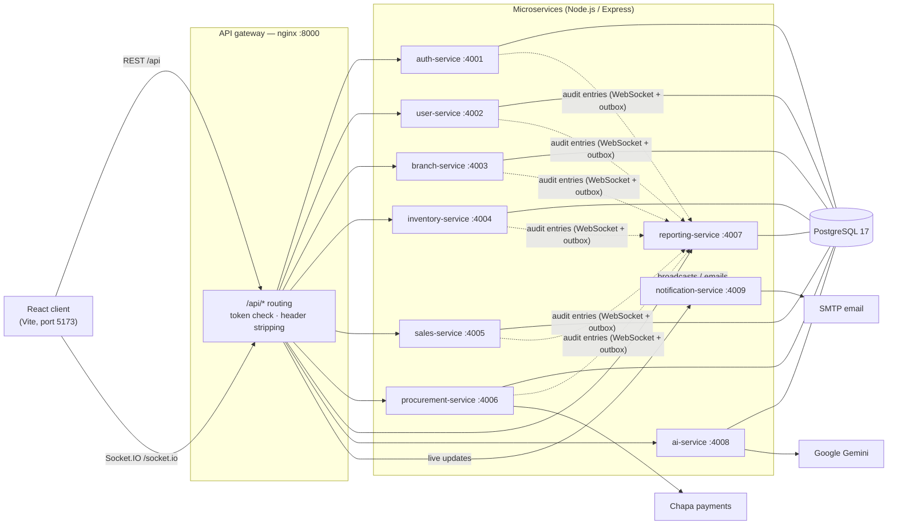

# Multi-Branch Supermarket Inventory Management System

A web system for running stock, purchasing and sales across several supermarket branches. It is built on a
**microservices architecture**: nine independent Node.js services behind an nginx API gateway, with a React client.
Inside every service the code follows a **layered organization** (routes → middleware → controllers → services →
repositories → models).

Stock is tracked by batch, and sales follow **FEFO (First Expired, First Out)**: the batch that expires soonest is sold
first. Every change is recorded in an audit trail that can't be edited or deleted.

---

## Contents

- [Users and roles](#users-and-roles)
- [Functional requirements](#functional-requirements)
- [Non-functional requirements](#non-functional-requirements)
- [System architecture: microservices](#system-architecture-microservices)
- [Code organization: layered](#code-organization-layered)
- [Technology stack](#technology-stack)
- [Getting started](#getting-started)
- [Configuration](#configuration)
- [Project structure](#project-structure)

---

## Users and roles

Access is role-based (RBAC). Each user has one role, and the sidebar, pages and API routes follow it.

| Role | Branch scope | Works with |
|---|---|---|
| **Owner** | All branches | Dashboard, Account Provision, Branches, Reports (Sales, Inventory, Financial, Procurement, User), Audit Logs, AI Assistance |
| **Inventory Officer** | One branch | Inventory, Receive Stock, Stock Transfers, Damaged items, Expenses, Settings, Inventory Report, Notifications |
| **Cashier** | One branch | Sales, Sales Report |
| **Purchase Officer** | All branches | Purchase (procurement), Category & Product, Procurement Report |

---

## Functional requirements

### Accounts and access
- **FR-1** The Owner invites staff by email and assigns a role and a branch. The invited person sets their own password
  from the invitation link.
- **FR-2** The Owner can edit, activate, deactivate, resend the invitation for, or delete a staff account. A
  deactivated user is signed out everywhere.
- **FR-3** Users sign in with email and password, can reset a forgotten password by email, and are signed out after a
  configurable period of inactivity.
- **FR-4** The Owner sees every active session (user, device, IP address, last activity) and can end or remove one.
- **FR-5** The Owner sees **dormant accounts**: active accounts with no sign-in for a configurable number of days
  (`ACCESS_REVIEW_DORMANT_DAYS`), and can deactivate them in place.

### Branches and settings
- **FR-6** The Owner adds, edits, activates, deactivates and deletes branches. A branch with staff or history can't be
  deleted.
- **FR-7** The Inventory Officer maintains store settings such as low-stock and expiry warning levels.

### Catalog and procurement
- **FR-8** The Purchase Officer manages categories and products. Each product entry gets a system-generated
  **Batch ID** (`BT-00001`, …) when saved; the same product may be added again under a new Batch ID.
- **FR-9** The Purchase Officer creates a procurement by choosing category, product and **Batch ID**, supplier,
  quantity and total cost; the unit price is derived. Payment goes through Chapa.
- **FR-10** A Batch ID can be bought **once**. To buy the product again, a new entry (new Batch ID) is added.

### Inventory
- **FR-11** The Inventory Officer receives a paid order (**Receive Stock**) by choosing its Batch ID, enters the expiry
  date and selling price, and the units enter stock under that Batch ID.
- **FR-12** Stock is kept per branch, product and batch with its expiry date; the Inventory Officer can correct
  quantities and expiry dates.
- **FR-13** Stock moves between branches (**Stock Transfers**) and is received by the destination branch.
- **FR-14** Damaged or expired items are recorded and taken out of stock.
- **FR-15** Low-stock and expiry alerts are shown to the Inventory Officer.

### Sales and expenses
- **FR-16** The Cashier records a sale by category and product; the batch is chosen automatically by **FEFO**. A sale
  is never recorded twice, even if the request is retried.
- **FR-17** The Inventory Officer records and deletes branch expenses.

### Reporting, audit and AI
- **FR-18** Reports for any period and branch, exportable to PDF: Sales, Inventory, Financial (profit and loss),
  Procurement and User (access review).
- **FR-19** The Owner's dashboard shows sales, purchases, expenses and profit across branches.
- **FR-20** **Audit trail:** every create, update, approve, reject, delete, view, sign-in and sign-out is recorded with
  the acting user, time, module, record and a **before / after snapshot** of the changed data. The Owner can search,
  filter and page through it; entries can never be edited or deleted.
- **FR-21** An AI assistant (Google Gemini) answers questions about the figures the user's role may see.
- **FR-22** Screens update live (Socket.IO) when data changes elsewhere: sales, stock, sessions, audit entries.

---

## Non-functional requirements

| Area | Requirement | How it is met |
|---|---|---|
| **Security** | Only signed-in users with the right role reach protected data | The gateway resolves every bearer token through auth-service; each service checks the role per route |
| | Services can't be called directly from outside | `/internal/*` routes are refused by the gateway and require a shared `INTERNAL_SERVICE_SECRET` |
| | Identity can't be forged | The gateway strips identity headers sent by browsers before forwarding |
| | Passwords and tokens are protected | Passwords hashed with bcrypt; secrets are never stored in audit snapshots |
| | Abuse is limited | Rate limits on sign-in, password reset, invitations and the AI assistant |
| **Data integrity** | Stock can't go negative or be double-counted | Database constraints, row locks, and idempotency keys on sales and stock movements |
| | Audit records are immutable | A database trigger refuses `UPDATE`, `DELETE` and `TRUNCATE`; services connect with a login that can only add and read audit entries |
| **Reliability** | No audit entry is lost when a service is down | Transactional outbox: entries are saved locally first and delivered over a WebSocket with acknowledgement and retry |
| | A failing service doesn't break others | Each service runs in its own container with its own restart policy |
| **Performance** | Large lists stay fast | Server-side filtering and **cursor (keyset) pagination** on the audit log; indexed queries |
| **Scalability** | Services scale independently | Stateless services behind the gateway; each service owns its own tables and migrations |
| **Maintainability** | Code is easy to find and change | One service per business area; the same layered structure in every service |
| **Usability** | Works on desktop and mobile browsers | Responsive React UI; clear validation messages under each field |
| **Auditability** | Who did what, and when, is always known | FR-20, plus dormant-account and role-change reviews |
| **Time handling** | "Today" means the store's day | Times stored in UTC and shown in the store's time zone (`STORE_TIMEZONE`) |

---

## System architecture: microservices

The backend is a **microservices architecture**: each business capability is a separately built and deployed service
with its own API, its own database tables and its own migrations. The browser talks only to the **API gateway**.



### Services

| Service | Port | Responsibility | Owns tables |
|---|---|---|---|
| **api-gateway** (nginx) | 8000 | Single public entry point; routes `/api/*` to the owning service; checks tokens through auth-service; blocks internal paths | — |
| **auth-service** | 4001 | Sign-in / sign-out, tokens, password reset, session monitoring, inactivity timeout | `personal_access_tokens`, `account_sign_ins`, `password_reset_tokens` |
| **user-service** | 4002 | Staff accounts, invitations, roles, access reviews (User Report) | `users`, `account_invitations`, `account_role_changes`, `account_changes`, `access_reviews` |
| **branch-service** | 4003 | Branches and store settings (policy) | `branches`, `policy_settings` |
| **inventory-service** | 4004 | Product catalog and Batch IDs, stock per batch, transfers, damaged items, stock movements | `products`, `stock_batches`, `stock_movements`, `stock_transfers`, `stock_adjustments`, `damaged_items` |
| **sales-service** | 4005 | Sales (FEFO) and expenses | `sales`, `expenses` |
| **procurement-service** | 4006 | Categories, purchase orders, Chapa payments, receiving deliveries | `procurement_categories`, `procurements` |
| **reporting-service** | 4007 | Reports, Owner dashboard, the audit log (its only writer) | `audit_logs` |
| **ai-service** | 4008 | Role-specific AI recommendations and chat through Google Gemini (read only) | — |
| **notification-service** | 4009 | Socket.IO live updates and outgoing email | — |

### How the services communicate

| Path | Mechanism |
|---|---|
| Browser → system | REST over HTTP through the gateway (`/api/...`); the gateway removes `/api` and forwards to the owning service |
| Authentication | nginx `auth_request` asks auth-service who owns the bearer token, then forwards the identity to the service as a signed context header |
| Service → service | Internal REST calls under `/internal/...`, authenticated with `INTERNAL_SERVICE_SECRET` (e.g. procurement-service asks inventory-service to add received stock) |
| Audit entries | Each service saves the entry to an `audit_outbox` table, then pushes it to reporting-service over a **Socket.IO WebSocket**; it is removed only after reporting-service acknowledges it |
| Live updates | Services send broadcasts to notification-service, which pushes them to browsers over Socket.IO |
| Database | One PostgreSQL server; each service creates and migrates **only its own tables** at start-up and reads other services' tables only where a report needs them |

---

## Code organization: layered

Every backend service uses the **same layered structure**. A request passes down through the layers, and each layer
only calls the one below it:

```
HTTP request
   │
   ▼
routes/         Which URL and method maps to which controller; which middleware guards it
   │
   ▼
middleware/     Sign-in and role checks, input validation, rate limits, loading the record in the URL
   │
   ▼
controllers/    Read the validated request, call a service, shape the JSON response (no business rules)
   │
   ▼
services/       Business rules: FEFO, Batch IDs, payments, audit entries, transactions
   │
   ▼
repositories/   SQL queries against PostgreSQL (the only layer that touches the database)
   │
   ▼
models/         Table names, constants and how a database row becomes an API resource

utils/          Shared helpers: config, database pool, errors, logging, time, events (audit / broadcasts)
migrations/     SQL files that create and change this service's tables, applied once each at start-up
```

A typical service folder:

```
server/inventory-service/
├── index.js              # creates the service: routes, scheduled jobs, start-up
├── migrate.js            # applies migrations/*.sql
├── migrations/
├── routes/
├── middleware/
│   └── validators/
├── controllers/
├── services/
├── repositories/
├── models/
└── utils/
```

The React client is organized the same way, by layer:

| Folder | Role |
|---|---|
| `api/` | Calls to the backend, one file per area |
| `pages/` | One component per screen |
| `components/` | Shared UI pieces (tables, tags, cards) |
| `features/<area>/` | Each area's components, models, rules and Redux store slices |
| `redux/` | The Redux store |
| `hooks/` | Shared React hooks |
| `layouts/` | Page shells (dashboard with sidebar, sign-in) |
| `routes/` | Paths and role-based navigation |
| `utils/` | HTTP client, dates, stock (FEFO) helpers |

---

## Technology stack

| Layer | Technology |
|---|---|
| Client | React 19, Vite, Redux Toolkit, React Router, TanStack Table, Socket.IO client, jsPDF, Lucide icons |
| Backend services | Node.js 22, Express 5, Zod, node-cron, Luxon, bcrypt, Socket.IO |
| Database | PostgreSQL 17 |
| Gateway | nginx |
| Integrations | Google Gemini (AI), Chapa (payments), SMTP (email) |
| Deployment | Docker, Docker Compose |

---

## Getting started

### Prerequisites
- Docker and Docker Compose
- Node.js 22+ (for running the client)

### 1. Configure the services

Every service reads its own `.env`. Create them from the examples:

```bash
cd server
for s in */; do cp -n "$s.env.example" "$s.env" 2>/dev/null; done
```

Then set the **same** `INTERNAL_SERVICE_SECRET` in every `.env`. Generate one with:

```bash
node -e "console.log(require('crypto').randomBytes(32).toString('hex'))"
```

Also fill in `GEMINI_API_KEY` (ai-service) and the `MAIL_*` settings (notification-service) if you want AI answers and
email invitations.

### 2. Start the backend

```bash
cd server
DB_PASSWORD=choose-one DB_APP_PASSWORD=choose-another docker compose up --build -d
```

This starts PostgreSQL, the gateway and all nine services. Each service applies its migrations when it starts.

### 3. Create the Owner account

```bash
docker compose exec auth-service npm run seed
```

Sign in with the Owner account and change its password straight away.

### 4. Start the client

```bash
cd client
cp .env.example .env
npm install
npm run dev
```

Open <http://localhost:5173>. The API is served at <http://localhost:8000/api>.

---

## Configuration

Most settings live in each service's `.env`. The most useful ones:

| Setting | Service | Meaning |
|---|---|---|
| `INTERNAL_SERVICE_SECRET` | all | Shared secret for service-to-service calls; must be identical everywhere |
| `STORE_TIMEZONE` | all | The store's time zone for "today", reports and the dashboard |
| `DB_PASSWORD` / `DB_APP_PASSWORD` | docker compose | Admin login (migrations) / limited login the services run as |
| `SESSION_TIMEOUT_MINUTES` | auth-service | Sign out after this many minutes without activity |
| `ACCESS_REVIEW_DORMANT_DAYS` | user-service, reporting-service | Days without sign-in before an account counts as dormant (keep both equal) |
| `CHAPA_MODE`, `CHAPA_SECRET_KEY` | procurement-service | `fake` for local testing, or real Chapa payments |
| `GEMINI_API_KEY`, `GEMINI_MODEL` | ai-service | Google Gemini key and model for AI Assistance |
| `MAIL_*`, `MAIL_FROM_NAME` | notification-service | SMTP settings for invitation and password-reset emails |
| `VITE_API_URL` | client | Where the client finds the gateway (default `http://localhost:8000/api`) |

---

## Project structure

```
.
├── client/                    # React web app (layered: api, pages, components, features, redux, …)
└── server/
    ├── docker-compose.yml     # PostgreSQL, gateway and all services
    ├── api-gateway/           # nginx gateway (Docker)
    ├── nginx/                 # gateway config for running services without Docker
    ├── auth-service/
    ├── user-service/
    ├── branch-service/
    ├── inventory-service/
    ├── sales-service/
    ├── procurement-service/
    ├── reporting-service/
    ├── ai-service/
    └── notification-service/
```
